

# Search Engine Project

Stage 2: Building a Service-Oriented Architecture

| | |
|---|---|
| **Course** | Big Data, Grado en Ciencia e Ingeniería de Datos, Universidad de Las Palmas de Gran Canaria |
| **Academic year** | 2026/2027 |
| **Group** | Calima Data |
| **Members** | Guillermo Oltra Rodriguez (student ID: to be added) Abdelaziz Choukri (student ID: to be added) |
| **Repository** | https://github.com/Calima-Data/stage_2 |

<!-- TOC -->

## 1. Introduction and objectives

Stage 1 built and measured a data layer: a datalake of books and an inverted index. Stage 2 turns it into cooperating
services that run as separate processes on one machine, and asks how far that design goes and what stops it.

The main goals achieved are:

- **Three services and an orchestrator**, in Java 17 with Javalin and Gson: Ingestion, Indexing and Search, coordinated by
  a Control Module. Each one is its own process, with its own executable jar and configuration.
- **A correct pipeline under failure.** A book is indexed only after ingestion has completed, and it becomes searchable
  all at once. Crashes at exact lines, service outages and concurrent duplicates lose and duplicate nothing: 17 of 17
  failure scenarios pass.
- **A documented API**, with the front-end contract separate from the internal one, in OpenAPI 3. An automated check
  validates the running services against it: 25 of 25 checks pass.
- **Measured limits.** Component and whole-system benchmarks separate client concurrency, threads and replicas.

The benchmarks changed the system as well as describing it. They exposed two real defects, writer starvation and
unbounded growth of the write-ahead log, and an avoidable cost in the order of index writes. All three were fixed, and
section 6.8 shows the numbers before and after. The main finding is that publication to the index, which is serial
and gets slower as the index grows, is what limits the pipeline. Neither threads nor replicas on one host raise it.

Every number in this report comes from a file in `results/stage2/`. The method and its limits are in section 6.1.

## 2. System architecture

### 2.1 Components and boundaries

Figure 1 shows the deployment. All processes run on one host, and they share its CPU, memory and disk.

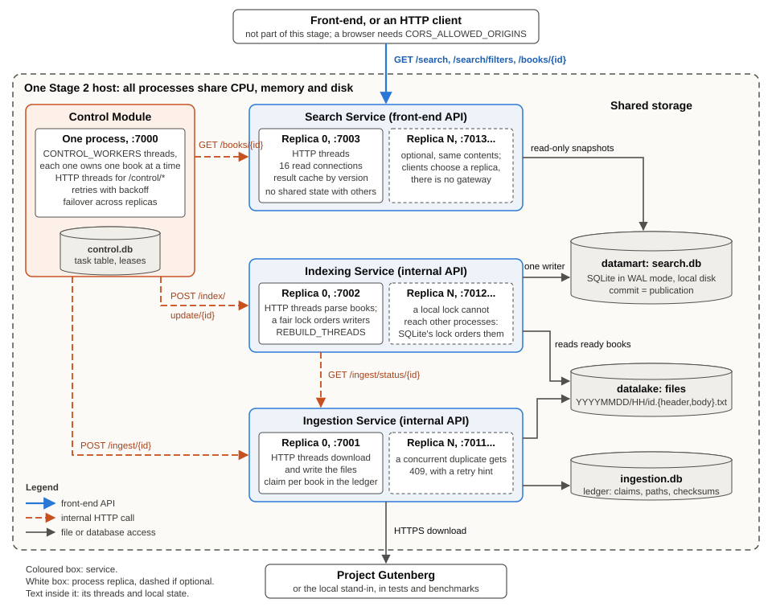

**Figure 1.** Deployment on one host. Blue: the front-end API. Orange: internal HTTP calls. Grey: file and database access.

| Component | Responsibility | Owns | Reads |
|---|---|---|---|
| **Ingestion Service** | Downloads a book, splits header and body, stores them in the time-based datalake | Datalake, `ingestion.db` | Project Gutenberg |
| **Indexing Service** | Extracts metadata, builds term frequencies, publishes to the datamart | Datamart, `search.db` | Datalake files of ready books |
| **Search Service** | Keyword search, filters, BM25 ranking, pagination | Result cache in memory | Datamart, read-only |
| **Control Module** | Decides what runs next, records progress, retries | `control.db` | Nothing else |

A front-end only ever talks to the Search Service, over HTTP. It needs no file paths, no database access and no
knowledge of the orchestrator. No front-end is built in this stage; `scripts/api_check.py` exercises the same contract.

### 2.2 Coordination: classical orchestration

Each book moves through `PENDING → INGESTED → INDEXED → PUBLISHED`, or ends in `FAILED`. Figure 2 shows one book.

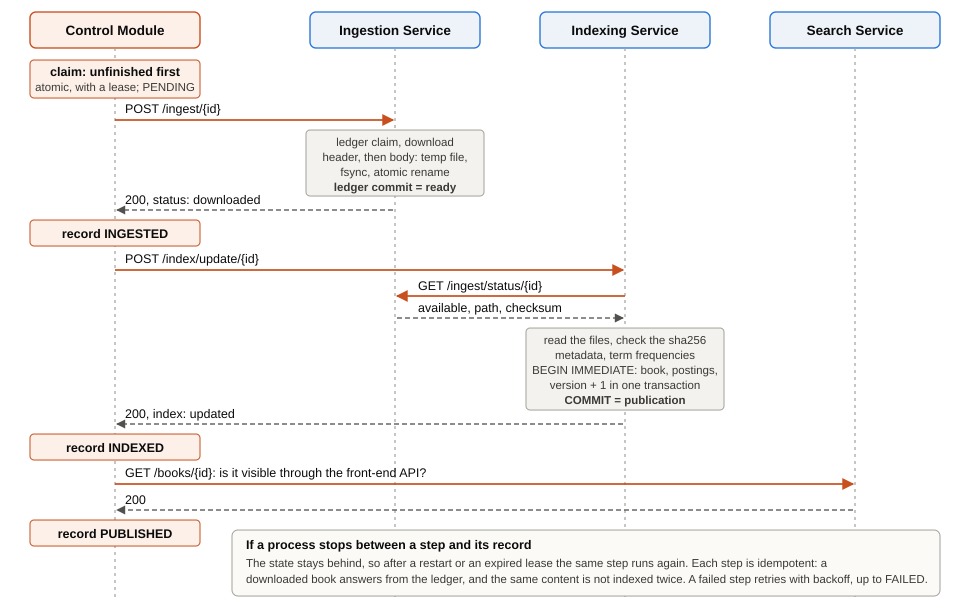

**Figure 2.** One book through the workflow, and what happens if a process stops between a step and its record.

The dependencies from the assignment are enforced as follows:

- **Ingestion before indexing.** The Control Module orders the steps, and in addition the Indexing Service asks
  `GET /ingest/status/{id}` before it reads a book. A book is `available` only after both files are complete and the
  ledger has committed, so this holds whoever calls indexing.
- **Publish before search.** Metadata, postings and the version counter change in one SQLite transaction. Search reads
  inside a snapshot, so it sees a book completely or not at all. The commit is the publication.
- **Completion is checked where it matters.** `PUBLISHED` is recorded only after `GET /books/{id}` answers 200 on the
  Search Service, which proves that front-ends can see the book.

### 2.3 Processes, replicas and threads

Replication adds processes; threading adds concurrency inside one process. The two are separate settings, and every
experiment reports them separately from client concurrency.

| Service | Replicas | Ports | Threads | How work reaches them | Local state and its protection |
|---|---|---|---|---|---|
| Control Module | 1 | 7000 | `CONTROL_WORKERS` (default 4), each owning one book at a time | Atomic claim in `control.db` | None between threads: the table is the state |
| Ingestion | 1..N | 7001, 7011... | Javalin default: Jetty pool, at most 250, or `HTTP_THREADS` | Rotation by the caller, skipping unreachable replicas | Per-book claim in the ledger, shared by replicas |
| Indexing | 1..N | 7002, 7012... | The same; `REBUILD_THREADS` (default 4) parse during a rebuild | Rotation by the caller | Fair lock in the process; SQLite's write lock across processes |
| Search | 1..N | 7003, 7013... | The same; `SQLITE_POOL_SIZE` (default 16) read connections | Rotation by the client; no gateway | Result cache, thread-safe and keyed by index version |

An in-process lock does not reach other replicas. Indexing therefore has two levels: the fair lock orders threads in one
process, and `BEGIN IMMEDIATE` orders processes. The first exists because SQLite's busy handler alone starved writers
(section 6.8).

Thread exhaustion is bounded in two ways. Jetty's pool has a maximum, and a Search request that finds no free database
connection within the busy timeout answers `503` rather than queuing without limit.

### 2.4 What depends on a single host

These assumptions are recorded so that Stage 3 can remove them, as discussed in section 7.2:

- **Addresses.** All URLs default to `localhost`. They are configurable lists, so this needs configuration, not code.
- **Files.** Indexing reads the datalake directly, as a local path.
- **SQLite.** The datamart relies on WAL shared memory and file locks, which require processes on one host and a local
  file system. It must not sit on a network file system.
- **In-process locks.** The fair write lock covers one process.
- **One Control Module.** At startup it releases every claim, assuming that they all belong to a dead process.

## 3. API design and contracts

The specification is [`api/openapi.yaml`](../api/openapi.yaml), version 2.0.0, and the inventories with callers, timeouts and
failure behaviour are in [`api/ENDPOINTS.md`](../api/ENDPOINTS.md). Runnable examples are in
[`api/requests.http`](../api/requests.http).

### 3.1 Front-end API

**Use cases.** A person searches by keyword, narrows the results by author, language or year, moves through pages of
results, opens one book, and fills filter controls with values that exist.

| Method and route | Provider | Consumer | Purpose | Status codes |
|---|---|---|---|---|
| `GET /search` | Search | Front-end | Keyword search with filters, ranking and pagination | 200, 400, 503 |
| `GET /search/filters` | Search | Front-end | Values for filter controls | 200, 503 |
| `GET /books/{book_id}` | Search | Front-end; Control Module as its last step | Metadata of one published book | 200, 400, 404, 503 |

`GET /search?q=...&author=...&language=...&year=...&offset=...&limit=...`, where only `q` is required:

- **Pagination.** `offset` defaults to 0, up to 1 000 000. `limit` defaults to 20, up to 100. `total` counts all matches,
  and `results` holds only the page. An offset beyond the matches is a valid empty page.
- **Ordering.** BM25 descending (`k1=1.2`, `b=0.75`), then `book_id` ascending, which keeps pages stable.
- **Query.** Several terms mean AND. Tokens are Unicode-aware with diacritics removed, so `espana` finds `España`.
- **Filters.** `author` is a substring, ignoring case and diacritics. `language` is an exact ISO 639-1 code; `und` means
  unknown. `year` is an exact year of original publication.
- **Errors.** A valid query with no matches is `200` with an empty list. Malformed values, unknown parameters and
  repeated parameters are `400` with `{"error": <stable code>, "message": <text>}`, because a misspelled filter that was silently ignored
  would return results that look correct.

**A limitation in the data.** Gutenberg headers rarely give a year of original publication: none of the 20 books in the
benchmark corpus do. The "Release date" field dates the eBook, and would place *Pride and Prejudice* in 1998. The year
therefore comes from an explicit header line or a curated list of well-known books. Other books have `year: null` and
never match the year filter. The contract states this.

**Browser access.** A front-end on another origin needs `CORS_ALLOWED_ORIGINS` on the Search Service. It is empty by default.

### 3.2 Internal API

| Method and route | Provider | Caller | Step | Timeout | Caller's behaviour on failure |
|---|---|---|---|---|---|
| `POST /ingest/{id}` | Ingestion | Control | From PENDING | 60 s | Retries 409, 5xx and connection errors on the next replica. FAILED on 400, 404, 422 |
| `GET /ingest/status/{id}` | Ingestion | Indexing | Readiness check | 10 s | Answers 503 to its own caller |
| `GET /ingest/list` | Ingestion | Indexing | Start of a rebuild | 10 s | Answers 503 to its own caller |
| `POST /index/update/{id}` | Indexing | Control | From INGESTED | 60 s | `409 book_not_ready` returns the task to PENDING. Retries 500, 503 and connection errors. FAILED on 400 |
| `GET /books/{id}` | Search | Control | From INDEXED | 5 s | Retries without repeating indexing |

**Completion semantics.** All of these are synchronous: a `200` means the work is finished and durable. Control's
`POST /control/books` answers `202`, accepted only, and the caller observes the outcome through `GET /control/books/{id}`.

**Idempotency.** Repeating `POST /ingest/{id}` answers `already_available`. Concurrent calls download once, and the others get
`409 ingestion_in_progress` with a retry hint. Repeating `POST /index/update/{id}` with the same content answers `unchanged`,
and concurrent calls publish once. Retries use exponential backoff with jitter, from 500 ms up to 30 s, and a task
becomes FAILED after 8 failures of one step. `POST /control/books/{id}/retry` reverses that.

**Calls that are absent, and non-HTTP contracts.** There is no publish call, because the commit publishes. There is no
cache-refresh call, because cache entries carry the index version and hit only for the version of the current
snapshot, so invalidation cannot be missed across replicas. The system uses no broker, schedule or shared memory. The
only contracts outside HTTP are two storage rules, which the specification records: the datalake is written only by
Ingestion and read by Indexing only after `available`; the datamart is written only by Indexing and read by Search in
read-only snapshots.

### 3.3 Operational endpoints

Documented separately, for operators and scripts: `GET /status` on all services, `POST /control/books`,
`GET /control/books/{id}`, `POST /control/books/{id}/retry`, `GET /control/status`, `POST /index/rebuild`, `GET /index/status` and
`GET /index/status/{id}`.

### 3.4 Validation evidence

No front-end is needed to assess the APIs. Both scripts deploy everything against a local Gutenberg stand-in.

| Check | What it does | Result | Report |
|---|---|---|---|
| `scripts/api_check.py` | Keyword search, each filter and combinations, empty results, invalid parameters, pagination, internal operations. Validates each response against the OpenAPI schemas, and fails if a documented route was not exercised | **25/25** | `results/stage2/api_validation.json` |
| `scripts/failure_check.py` | Crashes processes at exact lines, takes services down, runs concurrent duplicates across replicas, then checks for lost, duplicated or partially visible data | **17/17** | `results/stage2/failure_checks.json` |
| `mvn clean package` | JUnit tests of all modules | **75/75** | Maven output |
| `bench_integration.py real-gutenberg` | 12 real books through the real site, with queries on the result | 12 published, 0 failed | `results/stage2/integration/real_gutenberg.json` |

The real-site queries return what they should: `q=whale&year=1851` finds *Moby Dick*, `q=rabbit&author=carroll` finds *Alice's
Adventures in Wonderland*, and `q=espana&language=es` finds *Don Quijote*.

## 4. Microservice implementation

### 4.1 Structure and technologies

`stage2/` is a Maven aggregator. Each service is a module with its own `pom.xml`, standard layout and executable jar, and can
be built alone with `mvn -pl <module> -am package`. The module `common` holds what would otherwise be duplicated: configuration,
HTTP conventions, SQLite access, the tokenizer and the HTTP client with failover. This duplication was one of the
corrections to Stage 1.

| Technology | Use |
|---|---|
| Java 17, Javalin 6.1.3 | HTTP services; Jetty supplies the thread pool |
| Gson 2.11 | JSON |
| sqlite-jdbc 3.46 | Datamart, ledger and task table |
| JUnit 5, JMH 1.37 | Tests and benchmarks under `src/test/java`, which never reach the service jars |

### 4.2 How each service implements its contract

**Ingestion.** `POST /ingest/{id}` claims the book in the ledger with a lease. It downloads the text and splits it, and it
writes each file through a temporary name, `fsync` and an atomic rename. Only then does it commit the ledger entry with the path,
sizes and checksum, and that commit is what makes the book ready. A retry reuses the path of the first attempt, so a retry in
a later hour cannot leave a second copy in the time-based layout. The ledger also removes that layout's weakness, measured in
the Stage 1 addendum: finding a book by ID no longer walks the folders.

**Indexing.** `POST /index/update/{id}` checks readiness over HTTP, reads the files and compares their checksum with the ledger's.
It parses in parallel across request threads, and then takes the fair lock and `BEGIN IMMEDIATE`. In one transaction it
replaces the book and its postings, inserted in the order of the clustered key, and increments the version. If the same content
is already published, it answers `unchanged`. `POST /index/rebuild` parses with `REBUILD_THREADS` and replaces everything in
one transaction, so a crash leaves the published index intact and search sees the old or the new one, never a mixture.

**Search.** It opens the datamart read-only. Each request gets a pooled connection and one snapshot, and in that snapshot it
reads the version, the cache, the ranking and the metadata, so totals and results describe the same index state. Tokenization
is the same code as in indexing.

**Control Module.** `CONTROL_WORKERS` threads each claim a task and run its next step.

### 4.3 Readiness, ownership, retries and recovery

- **Task ownership.** A claim is one transaction that sets an owner and a lease. The order is INDEXED, then INGESTED, then
  PENDING, so an interrupted system finishes what it started before it downloads anything new.
- **Retries.** Each failure stores the next attempt time, with backoff, in the table. Permanent errors such as `404` go straight
  to FAILED. A service that is down delays work, and does not lose it.
- **Failover.** The client rotates over the replica endpoints and skips one that cannot be reached. An HTTP error is
  returned to the caller, because the replica did answer and only the caller knows whether to retry.

**If a process stops between completing an operation and recording it**, the state in the table stays behind, and the step runs
again after a restart or an expired lease. This is safe because each step is idempotent:

| Process that stops | Moment | What happens next | Scenario in `failure_check.py` |
|---|---|---|---|
| Ingestion | After the claim, between files, or before the commit | The book is not ready. The lease expires and the download repeats on the same path | Yes, all three |
| Ingestion | After the commit | The retry answers `already_available` | Yes |
| Indexing | Before the commit | The transaction is lost, and nothing was visible | Yes |
| Indexing | During a rebuild | The published index stays in place | Yes |
| Control | After ingestion, or after indexing, before recording | The step repeats, and answers `already_available` or `unchanged` | Yes, both |
| Control | After the final check, before recording | The check repeats | Yes |

The scripts also check that an indexing outage is retried, that a search outage delays only the last step, that search keeps
serving while the pipeline is down, that replicas fail over, and that duplicates across replicas produce one result.

## 5. Design decisions

The complete list, with 31 decisions and their reasons, is in [`docs/DECISIONS.md`](DECISIONS.md). These are the ones that shape
the system.

**Coordination mechanism: orchestration.** It keeps all workflow state in one inspectable table, and needs no extra process.
Choreography would need a broker on the same host, and time-based coordination adds delay and still needs readiness markers.
The cost is a central component. It measured about 3% of a book's time (section 6.4), so performance does not argue against it.
Availability does, for Stage 3.

**Single-machine deployment.** Required by the assignment. Ports, endpoints, paths, replica counts and thread settings are all
configurable, and `scripts/deploy.py` reproduces a deployment with one command.

**API.** A single search endpoint with optional filters, as the assignment asks. Strict validation, as explained in 3.1. Synchronous
internal calls, because a definite answer keeps the orchestrator simple.

**Storage.** The time-based datalake is the required hierarchy, paired with a ledger. SQLite in WAL mode was the best overall datamart
in Stage 1, and it gives atomic publication and consistent snapshots without further work. Postings are clustered by term, so a
search reads one contiguous range per term. Its price is that publishing touches one leaf page per distinct term, which
section 6.5 measures. This favours reads, as a search engine should, but it is the main limit found.

**Durability.** `synchronous=FULL`, because Control's state says a book is published, so it should survive a power cut. FULL and NORMAL
are indistinguishable when publishing (section 6.3), so the safer setting costs nothing measurable there.

**Concurrency model.** Threads for parallel work and replicas for availability, with a single writer on the datamart.

Where replication or threading helps, and where it contends, as measured on this host:

| Operation | Nature | Threads | Replicas on one host |
|---|---|---|---|
| Tokenizing and parsing | CPU, independent per book | Helps up to the physical cores: 6.7× at 8 threads | Not needed, because threads suffice |
| Publishing to the datamart | Serial by design: one writer | No gain: 11.5 → 9.9 books/s from 1 to 4 threads | No measurable gain, and memory doubles or quadruples |
| Searching | CPU, read-only snapshots | Helps up to about 8 to 16 threads | Worse: 7036 → 4645 requests/s from 1 to 4 |
| Downloading | Waits on the network | Concurrency absorbs upstream delay | No gain on the local stand-in |

**Replica counts and defaults.** The default is one replica of each service, because that is what the measurements justify on
one host. Replication is implemented and validated for correctness, and its value here is availability, not speed. Thread
defaults are kept (Jetty's pool, 16 read connections, 4 Control workers) because the results show no reason to tune them, except
that 2 Control workers already reach the same throughput as more.

## 6. Benchmarks and results

### 6.1 Method and host

| Item | Value |
|---|---|
| CPU | AMD Ryzen 7 4800H, 8 physical cores, 16 logical |
| RAM | 16 GB (15.4 GB usable) |
| Storage | Intel SSDPEKNW512G8L, 512 GB NVMe SSD |
| System | Windows 11 build 26300, OpenJDK 17.0.20.1 (Temurin), Python 3.13.5 |
| Revision measured | `8c1bfa7`. The host report flags the tree as dirty because of documents and figures outside the code |

| Level | Method |
|---|---|
| **Components (JMH)** | Isolated functions, no HTTP. 5 warm-up and 10 measurement iterations of 1 s, 2 forks, `-Xmx2G`. Error is JMH's 99.9% confidence half-width |
| **Whole system** | All services as processes, `-Xmx1g` each. 3 repeats per configuration, reported as mean ± standard deviation. Pipeline: 200 books from an empty index. Search: 500-book index, closed-loop clients, 5 s of warm-up and 15 s of measurement, with 20 query templates and every total checked against the expected answer |

**Limits of this evidence, which affect how the results should be read:**

- The host is a laptop in normal use, not an isolated machine. Windows Defender and other services kept running, against the
  assignment's advice to use an idle host. There was no other way to run this.
- The load generator and the Gutenberg stand-in run on the same host, and take CPU from the system under test: up to 4.5
  logical cores without cache and 5.9 with it. Search results below therefore understate what Search could do with the machine to itself.
- The stand-in replays 20 real books. New book IDs bring no new vocabulary, so the index grows less than with a real corpus.
- Data folders are outside OneDrive, because sync activity would falsify disk timings.

**Noise.** The same configuration, 32 clients with default threads and no cache, measured 7812 ± 187 requests/s in one experiment
and 7036 ± 64 in another, 10% apart. Standard deviations within an experiment understate this. **Differences below about 10%
across experiments are treated here as no evidence of an effect.**

**Stalls.** A few runs are far slower than their repeats, such as 3.04 books/s against 4.92 and 4.86. These are short periods
in which the disk stops keeping up, explained in section 6.6. They are kept in all means, since removing inconvenient
values is not defensible, so tables also list the individual runs where they matter.

The complete tables are in `results/stage2/summary_tables.md`.

### 6.2 Which measurements answer which question

| Question in the assignment | Answer in |
|---|---|
| Books ingested or indexed per second | 6.4, 6.5 |
| Search response time under concurrent load | 6.7 |
| CPU and memory as workload grows | 6.4, 6.7, 6.9 |
| Effect of client concurrency, threads and replicas | 6.4, 6.7 |
| Coordination overhead | 6.4 |
| Limits of the single machine, and changes needed for Stage 3 | 6.10, 7 |

### 6.3 Components (isolated)

| Operation | 1 thread | 2 | 4 | 8 | 16 |
|---|---|---|---|---|---|
| Tokenize one book (µs per op) | 2087 ± 57 | 2182 ± 153 | 2221 ± 20 | 2485 ± 72 | 4026 ± 268 |
| Publish that book, FULL (ms per op) | 87.3 ± 12.3 | 179.6 ± 23.9 | 406.0 ± 63.3 | | |
| Publish that book, NORMAL (ms per op) | 87.2 ± 12.6 | 177.3 ± 22.7 | 409.9 ± 63.3 | | |
| Search, rare term (µs per op) | 186 ± 2 | 200 ± 9 | 352 ± 53 | 612 ± 9 | 891 ± 6 |
| Search, common term (µs per op) | 721 ± 8 | 916 ± 30 | 719 ± 3 | 1190 ± 9 | 1595 ± 131 |
| Search, two terms (µs per op) | 941 ± 18 | 878 ± 11 | 1444 ± 17 | 1309 ± 214 | 1955 ± 109 |

Others, on one thread: metadata extraction 10.1 ± 0.03 µs, splitting header and body 1264 ± 2.5 µs, writing the two files with
`fsync` 9654 ± 4827 µs, and ledger claim and commit 2776 ± 986 µs. With 4 threads, the last two take 17 811 ± 14 055 µs and
10 181 ± 195 µs.

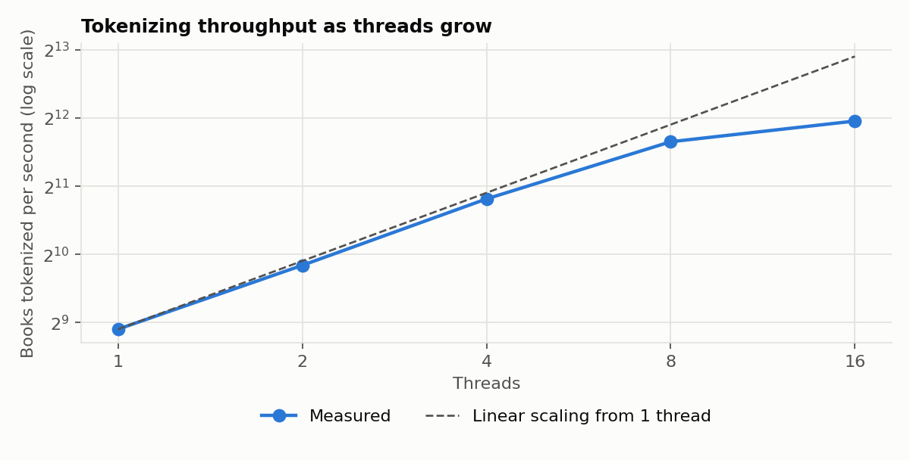

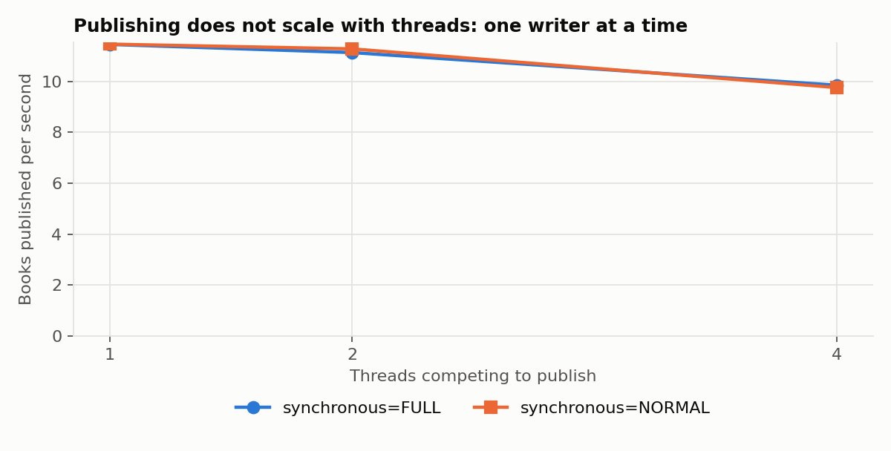

**Reading.**

- **The two parts of indexing behave in opposite ways.** Tokenizing scales 6.7× at 8 threads and 8.3× at 16, flattening beyond the 8 physical
  cores. Publishing is serial: the time per operation doubles with each doubling of threads, so throughput stays between
  11.5 and 9.9 books per second.
- **Publishing is what matters.** For the same book it costs 87 ms against 2 ms for tokenizing, so about 98% of this work is
  serial, and parallel parsing has almost nothing to gain. In this benchmark the database starts empty and grows.
- **`synchronous=FULL` costs nothing measurable when publishing** (87.3 against 87.2 ms). A commit waits for one `fsync`, which is small
  beside the work of the transaction.
- **File writes vary widely**, ±50% and ±79%, far more than CPU work. This is the first sign of the disk behaviour in section 6.6.
- **Search values are not monotonic at low thread counts.** Common term: 916 µs at 2 threads and 719 µs at 4. Their cause was not
  investigated, so only the general trend is relied on: latency per operation grows from 2× to 5× at 16 logical threads.

### 6.4 Pipeline: threads, replicas and coordination

Complete pipeline, 200 books, 1 replica of each service, default HTTP threads. There is no client load: the variable is Control Module
worker threads.

| Workers | Books/s | Each run | Index call (ms) | Ingest call (ms) | Visibility check (ms) | Coordination (ms) | Indexing CPU % | Host CPU % |
|---|---|---|---|---|---|---|---|---|
| 1 | 4.28 ± 1.07 | 3.04, 4.92, 4.86 | 206 ± 68 | 26.3 ± 2.5 | 3.3 ± 0.0 | 6.0 ± 0.6 | 60 ± 9 | 9.3 ± 0.2 |
| 2 | 6.28 ± 0.05 | 6.31, 6.32, 6.22 | 279 ± 3 | 25.9 ± 0.5 | 3.7 ± 0.2 | 5.7 ± 0.1 | 90 ± 2 | 11.9 ± 0.2 |
| 4 | 5.67 ± 1.69 | 3.72, 6.71, 6.57 | 663 ± 197 | 32.4 ± 1.4 | 4.8 ± 0.4 | 6.6 ± 0.8 | 87 ± 17 | 11.6 ± 1.4 |
| 8 | 6.46 ± 0.04 | 6.43, 6.50, 6.44 | 1141 ± 10 | 43.1 ± 1.5 | 6.0 ± 0.3 | 7.5 ± 0.4 | 100 ± 1 | 13.9 ± 0.6 |
| 16 | 6.37 ± 0.03 | 6.38, 6.33, 6.40 | 2265 ± 16 | 72.4 ± 1.1 | 5.9 ± 0.8 | 9.6 ± 0.3 | 107 ± 0 | 14.7 ± 0.3 |

CPU: 100% is one logical core; the host total is relative to all 16.

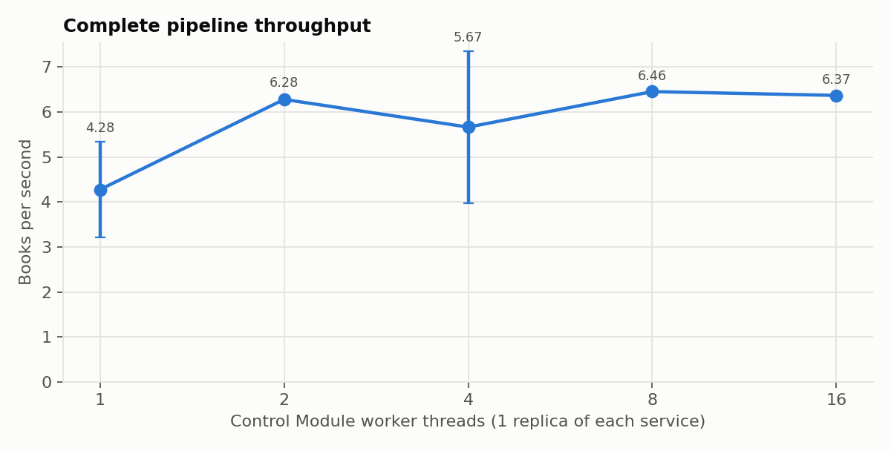

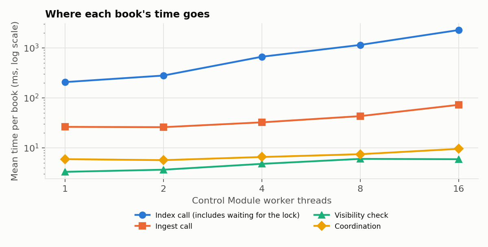

**Where it saturates, and why.** Throughput stops growing at 2 workers, at about 6.4 books/s, or **0.155 s per book**. Beyond that, each extra
worker only adds waiting: the index call goes from 279 to 2265 ms while throughput stays flat. The Indexing Service sits at one core
(100%), and the host is 86% idle. So this bottleneck is not a shortage of machine. It is one writer, inside one process.

**A check on these numbers.** With a fixed number of workers, Little's law says that workers ÷ throughput must equal the time per book. At 8
workers this gives 1.24 s, and the measured steps add up to 1.20 s. At 16 workers, 2.51 s against 2.35 s. The measurements are consistent with each other.

**Ingestion.** The ingest call is never the limit on the stand-in. Its 26 ms alone would allow about 38 books/s one at a time, a figure derived
from the call time, not measured in isolation. It grows to 72 ms with 16 workers; contention for the disk and the ledger is the likely reason, not a measured one. A real
download behaves differently: through the real site, with 2 workers on a 12-book index, the ingest call averaged **475 ms against 77 ms for the
index call**, and the run reached 3.2 books/s. On a small index, then, the network is the slowest step. Section 6.5 shows that this order reverses as the
index grows.

**Coordination overhead.** The time the Control Module spends claiming and recording state, per book, is 5.7 to 9.6 ms, about 3% of a
book's time with one worker. Its process uses 13% to 21% of one core. Queue wait is 10 to 20 s, but it measures the backlog, because all
200 books are submitted at once. It is not a coordination cost. **The orchestrator is not a bottleneck.**

Other configurations, each compared with 8 workers, 1 replica of each, FULL:

| Change (one factor) | Books/s | Each run | Coordination (ms) | Peak WAL (MB) | Effect |
|---|---|---|---|---|---|
| Baseline | 6.46 ± 0.04 | 6.43, 6.50, 6.44 | 7.5 | 29 | |
| 2 Indexing replicas | 6.58 ± 0.60 | 7.01, 6.84, 5.90 | 9.0 | 94 ± 5 | No clear gain; 700 MB of RSS against 374 |
| 4 Indexing replicas | 6.81 ± 0.14 | 6.96, 6.78, 6.69 | 7.6 | 112 ± 9 | +5%, within noise; 1320 MB of RSS |
| 2 Ingestion replicas | 6.13 ± 0.09 | 6.13, 6.22, 6.05 | 7.7 | 29 | No gain; host CPU 20.0% against 13.9% |
| `synchronous=NORMAL` | 5.47 ± 1.62 | 6.09, 3.63, 6.69 | 4.4 | 29 | No gain in throughput; coordination falls by 41% |
| Upstream +100 ms, 8 workers | 6.34 ± 0.03 | 6.36, 6.30, 6.35 | 7.6 | 29 | Hidden: ingest call 152 ms, same throughput |
| Upstream +100 ms, 1 worker | 3.21 ± 0.01 | 3.21, 3.22, 3.21 | 5.6 | 29 | Visible: one worker has to wait for it |

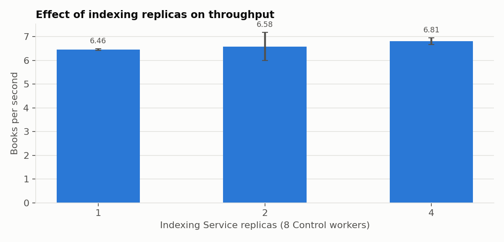

**Reading.**

- **Replicas of Indexing do not help on one host**, for a reason the design predicts: they all compete for the same write lock on the same file. They cost
  memory, and the log grows further (29 → 112 MB), because replicas take turns to write and leave fewer moments in which SQLite can restart it.
- **Replicas of Ingestion do not help either**, because Ingestion is not the limit. They add CPU.
- **Concurrency absorbs upstream latency**, as long as the writer stays the bottleneck. This holds for a constant delay of 100 ms, and was not tested with a failing upstream.
- **`NORMAL` reduces coordination cost by 41%**, which is the share of `fsync` in Control's records, but not the time per book, for the reason given in section 6.3. It
  would give up durability for nothing, so `FULL` stays. The mean of 5.47 reflects one stalled run.

Correctness across all pipeline runs: **0 failed books, 0 retries, and one index checksum per experiment**, so every configuration produced an identical index.

### 6.5 Publication as the index grows

The experiments above start from an empty index and stop at 200 books, which flatters the system. One longer run published 1000 books with 8 workers.

| Books in the index | 0-100 | 100-200 | 200-300 | 300-400 | 400-500 | 500-600 | 600-700 | 700-800 | 800-900 | 900-1000 |
|---|---|---|---|---|---|---|---|---|---|---|
| Books/s | 8.84 | 1.41 | 3.12 | 2.62 | 2.22 | 2.00 | 1.26 | 1.92 | 1.79 | 1.67 |
| Index + WAL (MB) | 28 | 61 | 89 | 111 | 133 | 154 | 173 | 192 | 211 | 208 |

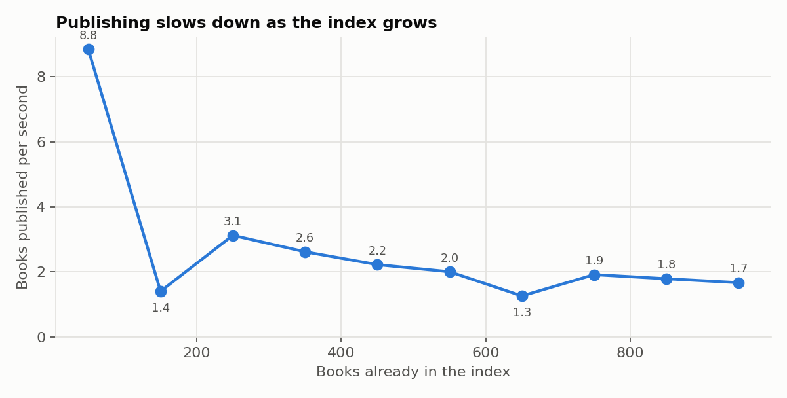

The windows 100-200 and 600-700 contain stalls (section 6.6). Ignoring them, **the rate falls about fivefold, from 8.84 to 1.67 books/s, as the index grows tenfold**.
Whole-run average: 2.02 books/s, 494.82 s, 0 failed. This is one run, so it shows the shape of the curve and not a precise value.

**Why.** Postings are clustered by term, so a book with 16 000 distinct terms touches about 16 000 places in the tree. Once the index is large enough, those are
mostly different leaf pages. `scripts/diagnose_publish.py` measured it directly on a 500-book index (`results/stage2/evidence/publish_diagnosis.txt`): one book of
16 392 postings writes **53 MB to the log**, which at 4096 bytes per page is about 13 500 pages. The source text of such a book is far smaller.

The disk counters in the diagnosis below agree. While publishing fell from 9.4 to about 2.1 books/s, the disk kept writing at 130 to 150 MB/s, so **the data written per book grew from about 15 MB to about 60 MB**.

Two remedies were tested on that same index, in ms per book, as medians of 6 repeats:

| SQLite page cache | Postings in random order | In key order |
|---|---|---|
| Default | 919 | 748 |
| 64 MB | 612 | 570 to 621, without the stalled repeats |
| 256 MB | 604 | 577 |

Inserting in key order costs nothing, and saves 19% with the default cache, so it was adopted. A larger cache would save a further 23%. It was left out because it applies per connection, and because the write path has to change for Stage 3 in any case.
In the row of 64 MB, three of six repeats in key order took 7.6 to 9.2 s; these are the stalls again.

### 6.6 Stalls: where the wait is

Some runs and windows were 2 to 5 times slower than their neighbours, with lower CPU use: in `writes_only`, one run published 12 books while the others published 51 and 64, and its
Indexing Service used 30% of a core against 71% and 84%. Waiting without working suggests I/O, but that needed checking.

`scripts/diagnose_stalls.py` runs the growth benchmark next to probes that share only the machine with it: a small file with its own `fsync` on the same disk, and a fixed amount of CPU work.

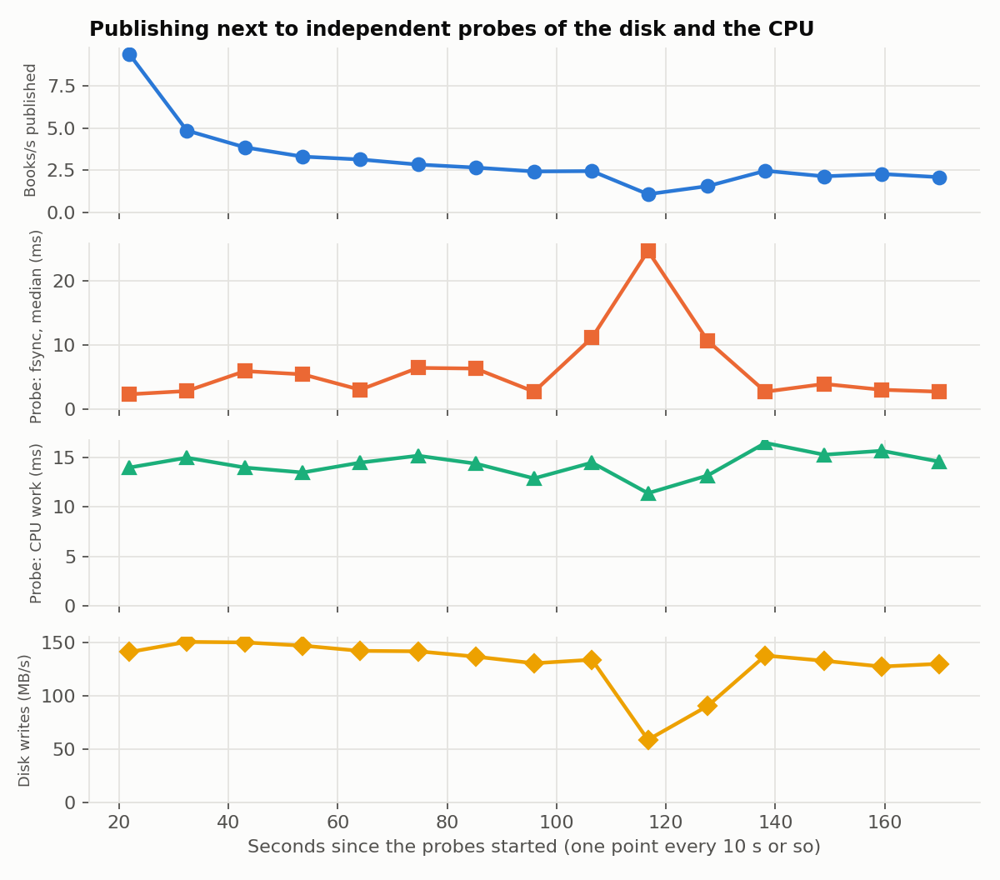

| Period (500-book run) | Books/s | Probe's `fsync`, median (ms) | Probe's CPU work (ms) | Disk writes (MB/s) |
|---|---|---|---|---|
| Before, 85 to 106 s | 2.43 to 2.45 | 2.7 to 11.1 | 12.9 to 14.5 | 130 to 134 |
| **Stall, 106 to 128 s** | **1.08 to 1.56** | **10.6 to 24.6** | 11.4 to 13.2 | **58 to 90** |
| After, 128 to 149 s | 2.14 to 2.47 | 2.7 to 3.9 | 15.3 to 16.5 | 133 to 137 |

**What this shows.** During a stall, a process unrelated to the services sees its `fsync` slow down several times over, its pure CPU work does not slow down, and the disk writes less. A first
run showed the same pattern at another moment (`results/stage2/evidence/stalls_first_run/`), and so did the plain SQLite script of section 6.5, which runs no services at all.
So **the wait is in the storage path, and not in the logic of the services.**

**Narrowing it down.** Three further checks, all on this laptop (plugged in, not on battery), with Windows Defender's real-time protection **on**:

1. **Defender, OneDrive and the indexer are not busy during stalls.** `diagnose_stalls.py --security-counters` also logged, about once a second, the CPU of the Defender engine (`MsMpEng`) and the Windows indexer, and the physical disk's queue (two 500-book runs, `results/stage2/evidence/stalls_security_run1/` and `_run2/`). In the stalled windows, `MsMpEng` used 0.0 to 2.5% of a core, less than in the normal windows (up to 20%). OneDrive's sync process was not running. The first attempt to record Defender had produced nothing because the Windows counters have localized names (here Spanish), which is why these runs use WMI classes instead.
2. **The queue is at the disk.** In run 2, during the three stalled windows (158 to 190 s) the physical disk had a queue of about 3 requests and a busy time of 240 to 315%, in the normal windows 0.1 to 1.3 requests and 40 to 80%, while the bytes written fell from about 120 MB/s to 7 to 14 MB/s. A queue at the physical disk means the requests are waiting for the device, not for something above it. (The latency column of that counter read 0 throughout and was discarded.)
3. **The disk does it alone.** `scripts/diagnose_disk_raw.py` writes 24 GB with an `fsync` every 16 MB and no service of this project running: the median rate was **13.6 MB/s**, 429 of 482 recorded seconds were below 50 MB/s, one block waited up to 6.2 s for its `fsync`, and the 4 KB probe saw up to 972 ms (`results/stage2/evidence/disk_raw/disk_raw.csv`). This run came right after the other benchmarks, so the drive was not rested.

The drive is an Intel SSDPEKNW512G8L, a consumer NVMe model that, according to published reviews of the Intel 660p family it belongs to, uses QLC memory with a dynamic SLC write cache whose size shrinks as the drive fills (see, for instance, the AnandTech review of the 660p: https://www.anandtech.com/show/13078/the-intel-ssd-660p-ssd-review-qlc-nand-arrives/9); this one was 85% full. Writes beyond that cache are much slower. That explains the pattern seen here (fast phases of about 130 MB/s, collapses lasting tens of seconds, recovery) and also the 10% variation between sessions, because the drive's speed depends on how much it was written to shortly before. **The conclusion is that the stalls come from the drive's behaviour under sustained writes, not from the services or from Defender's CPU.**

**What this does not show.** The services generate most of those writes, about 140 MB/s sustained, so they provoke the stalls that they then suffer. Defender was never disabled, and a scanning filter inside the kernel is not visible in `MsMpEng`'s CPU, so Defender is made unlikely by the three checks above, not excluded; the 13.6 MB/s of the raw test is also far below what a scanning filter would normally cost. The link with the SLC cache is an interpretation: I did not read the drive's internal state, because its health counters need administrator rights, and I did not repeat the raw test on a rested or emptier drive. Moving the data directory to an SSD with a stable write speed is the one change that would settle it. Consequently, **the throughput figures in this report are valid for this drive in the states it was in**, and the stalled runs are kept in every mean and table. An `fsync` peak does not always come with a slower pipeline either: the probe saw single values of up to 265 ms at other moments, which is why the median is used.

### 6.7 Search: client concurrency, threads, replicas and cache

1 replica, default HTTP threads, 16 read connections, no cache, 500-book index. **Client concurrency** is the variable:

| Clients | Requests/s | Mean (ms) | p50 | p95 | p99 | Host CPU % | Search CPU % | Generator CPU % | Search RSS (MB) |
|---|---|---|---|---|---|---|---|---|---|
| 1 | 699 ± 8 | 1.42 | 1.35 | 2.25 ± 0.04 | 2.71 | 14.8 | 103 | 79 | 250 |
| 2 | 1804 ± 25 | 1.10 | 1.05 | 1.75 ± 0.07 | 2.18 | 22.2 | 195 | 100 | 261 |
| 4 | 3618 ± 56 | 1.10 | 1.07 | 1.63 ± 0.02 | 1.84 | 36.7 | 358 | 169 | 274 |
| 8 | 5815 ± 47 | 1.37 | 1.33 | 2.06 ± 0.01 | 2.43 | 62.9 | 646 | 289 | 293 |
| 16 | 7737 ± 62 | 2.06 | 1.99 | 3.16 ± 0.04 | 3.78 | 90.0 | 987 | 370 | 308 |
| 32 | 7812 ± 187 | 4.08 | 3.82 | 7.04 ± 0.34 | 9.60 | 95.8 | 1023 | 426 | 300 |
| 64 | 7280 ± 39 | 8.73 | 7.33 | 18.80 ± 0.27 | 30.59 | 94.3 | 969 | 452 | 308 |

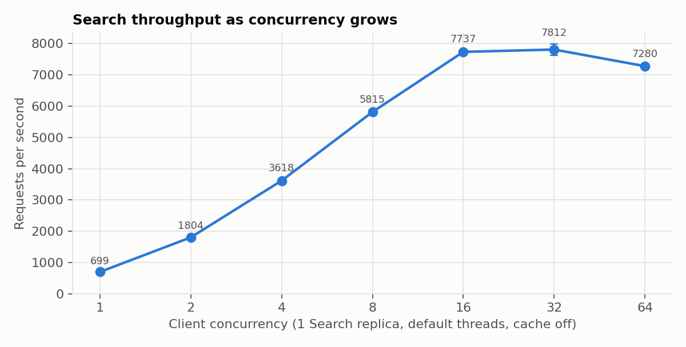

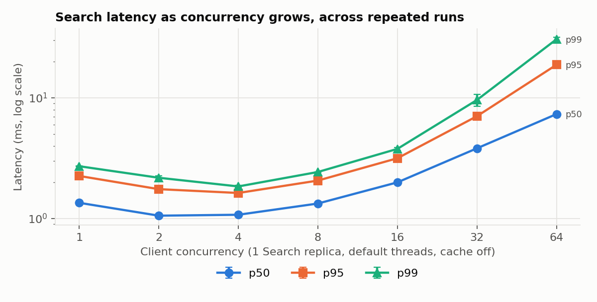

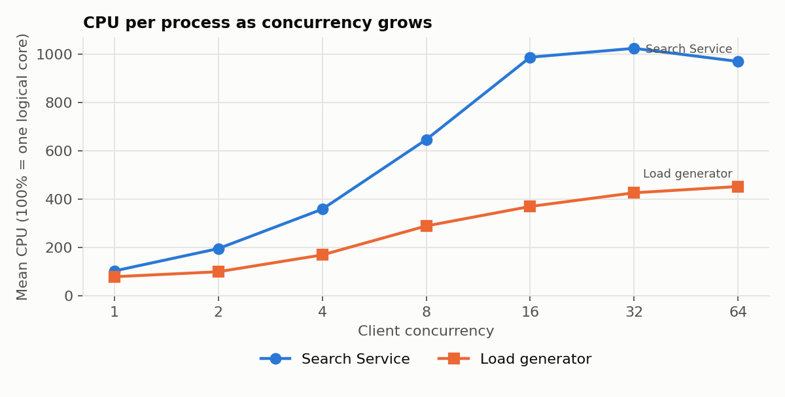

**Where it saturates, and why.** Throughput flattens at **16 clients, at about 7700 requests/s**, when the host reaches 90% CPU. From there, more clients only queue: from 16 to 64, p95 rises sixfold and throughput falls by 6%. Mean latency matches closed-loop queueing, since 32 clients ÷ 7812 requests/s = 4.1 ms. This bottleneck is **the host's CPU**, and not a lock: readers do not block each other, and Search uses about 10 of the 16 logical cores while the load generator uses 4 more. No request failed, and no total was wrong, in any configuration.

**The case of one client.** Two clients deliver 2.6 times as much as one. This is less odd than it looks. A client that waits for each answer can do at most one request per round trip, so throughput is clients ÷ latency. In a dedicated repeat (`scripts/diagnose_one_client.py`, 3 runs of 15 s each, interleaved, cache off), one client got 604 ± 4 requests/s with a median latency of 1.57 ms, and two got 1332 ± 13 with 1.42 ms: 2.2 times as much, which is what 2 ÷ 1.42 ms and 1 ÷ 1.57 ms predict, with the median understating the mean. Both the warm-up (30 s gave +9%) and a sleeping CPU are ruled out as the main cause: with 6 other processes keeping the cores busy, one client reached only 632 ± 7 (+5%) and two clients 1410 ± 46 (+6%). The remaining question is why the CPU cost per request falls from 1.76 ms with one client to 1.46 ms with two. Treating Search's CPU as a fixed part plus a part per request, the two points give 0.32 of a core and 1.22 ms per request, and that predicts 9.8 cores at 7737 requests/s, against the 9.9 measured in the 16-client run, which was not used for the fit. This is consistent with a fixed background load of about a third of a core in the JVM (compilation, garbage collection, idle threads), which is spread over fewer requests when one client is asking. That background load was **not measured directly**, so it remains an explanation that fits, not a proven one. The campaign's own 1-client figure (699) was 16% above this repeat (604), a difference of the size of the 10% noise between sessions that this report already warns about. Raw rows: `results/stage2/evidence/one_client/one_client.csv`.

**HTTP threads and read connections** per replica, 32 clients:

| Threads and connections | Requests/s | p50 (ms) | p95 (ms) | p99 (ms) | Search CPU % | Host CPU % |
|---|---|---|---|---|---|---|
| 1 | 1470 ± 90 | 26.24 | 48.28 ± 2.33 | 56.19 | 199 | 30.6 |
| 2 | 2702 ± 17 | 14.30 | 19.36 ± 0.14 | 22.77 | 367 | 46.1 |
| 4 | 4932 ± 30 | 7.26 | 9.39 ± 0.13 | 11.18 | 621 | 66.8 |
| 8 | 6914 ± 171 | 4.80 | 6.86 ± 0.25 | 8.76 | 888 | 88.1 |
| 16 | 7102 ± 16 | 4.17 | 7.83 ± 0.05 | 11.02 | 951 | 93.8 |
| 32 | 6964 ± 93 | 3.98 | 9.38 ± 0.29 | 15.29 | 956 | 95.2 |

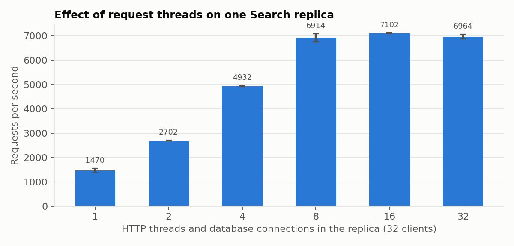

Doubling threads nearly doubles throughput up to 4. It gains 40% from 4 to 8, and nothing beyond, which matches the 8 physical cores, shared here with the load generator. **At 8 threads p95 is at its best**; more threads raise tail latency with no throughput to show for it. `HTTP_THREADS` counts request threads only, and Jetty adds its I/O threads on top, which is why one thread uses about 2 cores.

**Search replicas**, 32 clients, default threads:

| Replicas | Requests/s | p95 (ms) | p99 (ms) | Search CPU %, total | Host CPU % | Search RSS (MB), total |
|---|---|---|---|---|---|---|
| 1 | 7036 ± 64 | 8.72 ± 0.18 | 15.50 | 952 | 93.9 | 311 |
| 2 | 6119 ± 37 | 10.25 ± 0.03 | 20.22 | 992 | 96.2 | 568 |
| 4 | 4645 ± 318 | 16.19 ± 1.37 | 32.06 | 1034 | 96.1 | 1065 |

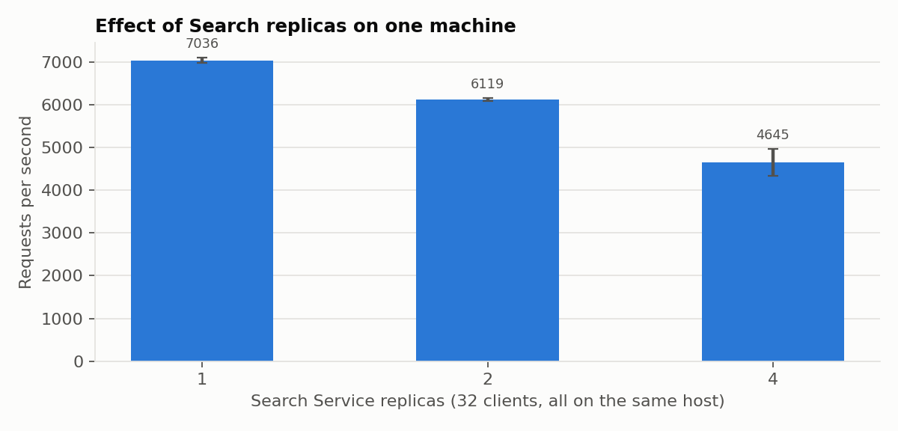

**Replicas make it worse on one host.** They use the same CPU, or a little more, to serve up to 34% fewer requests, so each request costs more, and they use more memory. One process with more threads uses this machine better. **This says nothing about replicas on separate machines**: it does not show that they would scale, and it does not show that they would not.

**Cache**, with 1000 entries, which is the default:

| Clients | Requests/s, no cache | Requests/s, cache | p95 (ms), no cache | p95 (ms), cache |
|---|---|---|---|---|
| 1 | 699 ± 8 | 1367 ± 31 | 2.25 | 1.18 |
| 8 | 5815 ± 47 | 7273 ± 54 | 2.06 | 1.23 |
| 32 | 7812 ± 187 | 12 522 ± 143 | 7.04 | 3.89 |

The benchmark's 20 templates repeat constantly, so nearly every request hits. **This is the best case**, an upper limit on the benefit, and not an estimate of what real and more varied queries would see. Throughput stops at 12 522 requests/s even so, with the generator at 589%, so HTTP and JSON are a real cost beyond the index.

### 6.8 Defects found by benchmarking, before and after

**1. Writer starvation.** A short JMH run on the ingestion ledger, two small transactions per operation, took 1.4 ms with one thread and about 1.8 s with four, with an enormous error. SQLite's busy handler sleeps with growing delays, even when the database is free, and that is unfair: some threads waited for seconds while others wrote repeatedly. Threads of one process now queue on a fair lock in `common`, which also protects the datamart, and latency is proportional to the number of threads. The final campaign confirms it: 2776 ± 986 µs with one thread and 10 181 ± 195 µs with four.

| Threads | Before (µs per op) | After (µs per op) |
|---|---|---|
| 1 | 1404 ± 214 | 1462 ± 229 |
| 2 | 67 481 ± 351 842 | 3326 ± 211 |
| 4 | 1 791 759 ± 8 675 939 | 7943 ± 1022 |
| 8 | 1 205 439 ± 5 920 223 | 15 844 ± 1737 |

These come from `results/stage2/jmh/contention_before_fix.txt` and `contention_after_fix.txt`, with 2 warm-up and 5 measurement iterations and one fork, shorter than the final campaign, which was enough to show the problem. The lock orders threads within one process. Across replicas, SQLite's own lock still applies, which the replica experiments measure.

**2. Unbounded write-ahead log.** SQLite restarts its log only when no connection is using it. With replicas taking turns, that moment never came: the first campaign ended with **1.3 to 1.9 GB** of index and log for a 61 MB index, and with coordination up to 359 ms per book. Writers now run a `TRUNCATE` checkpoint before writing once the log passes 64 MB, and wait for a checkpoint that is already running. Two new tests reproduce the failure: without the fix they reach 473 MB and 361 MB, and with it they stay under the ceiling of 96 MB in the test. The log can pass 64 MB, because one book can write 53 MB by itself: the highest peak in the final campaign is 119 MB.

**3. Order of index writes.** See section 6.5.

| Change, 8 workers (books/s) | 1 Indexing replica | 2 replicas | 4 replicas | Peak WAL or final size |
|---|---|---|---|---|
| First campaign, 3 runs | 4.10, 4.09, 4.12 | 3.63, 2.86, 3.02 | 3.96, 3.91, 4.02 | 1340 to 1897 MB at the end |
| With the bounded log, 2 runs | 2.88, 4.53 | 3.74, 4.38 | 4.31, 4.32 | Peak of 29, 97 and 120 MB |
| With key order too (final), 3 runs | 6.43, 6.50, 6.44 | 7.01, 6.84, 5.90 | 6.96, 6.78, 6.69 | Peak of 29, 94 and 112 MB |

Baseline throughput went from 4.10 to 6.46 books/s (+58%) and the log is bounded. The changes were measured across campaigns, on a shared host, and with stalls present. The ordering is the likely source of most of the gain, but this comparison does not isolate it precisely. The raw files of the earlier stages are in `results/stage2/evidence/`.

### 6.9 Reads and writes together

Each side alone and then both, on a 500-book index, 8 clients, cache off, 4 Control workers, 3 repeats of 30 s:

| Mode | Requests/s | p50 (ms) | p95 (ms) | p99 (ms) | Worst (ms) | Books/s published, each run | Peak WAL (MB) |
|---|---|---|---|---|---|---|---|
| Reads only | 4897 ± 63 | 1.55 | 2.62 ± 0.05 | 3.86 | 25 to 29 | | 52 |
| Writes only | | | | | | 0.37, 1.59, 2.00 | 54 |
| Both | 3721 ± 47 | 1.73 | 3.06 ± 0.03 | 5.25 | 318 to 480 | 1.16, 1.19, 1.16 | 101 |

**Reading.** Search keeps working during publication, as snapshots should allow: no errors, and p95 rises by only 17%. Throughput falls by 24% even though host CPU stays at 66%. To see whether this is competition for CPU, `scripts/diagnose_mixed_cpu.py` repeated the read-only run (same index, 8 clients, 30 s, cache off, 3 interleaved runs) while one or two processes did nothing but loop, taking about the core the indexer used (90% of a core) with no database, locks or disk. Reads fell only **2.2%** with one such process (4069 ± 115 against 4161 ± 70 requests/s) and **4.8%** with two (3960 ± 162), and the worst request stayed between 28 and 94 ms. So CPU competition explains at most a fifth of the 24%, and nothing of the 318 to 480 ms worst cases. The rest comes from the writes themselves, in the shared database. Readers discarding their page caches after each commit, and consulting a larger log, are the candidates, but **no run isolated them**, so the mechanism is not established. The repeat's read-only rate (4161) was 15% below this table's (4897) because the machine was in a different state, so only comparisons inside one experiment are valid. Raw rows: `results/stage2/evidence/mixed_cpu/mixed_cpu.csv`. Totals change during these runs, so they are not checked here. Writers lose about a third of their rate, comparing 1.8 books/s without the stalled run against 1.17. The rate here is about 1.2 to 2 books/s, as section 6.5 predicts at 500 books.

### 6.10 Bottlenecks and limits

| Component | What limits it | Kind | Where it starts | Evidence |
|---|---|---|---|---|
| **Publication** | One writer per datamart, and each book touching thousands of pages | **I/O and computation, under a lock** | From 2 Control workers; worse as the index grows | 6.3, 6.4, 6.5 |
| **Search** | CPU of the host, shared with the load generator | Computation | 16 clients, 90% host CPU | 6.7 |
| **Disk** | Stalls under sustained writes of about 140 MB/s | I/O | Unpredictable | 6.6 |
| Ingestion | Upstream network; not a limit on the stand-in | Network | With the real site, on a small index | 6.4 |
| Control Module | Not a limit: about 3% of a book's time | Coordination | Not reached | 6.4 |
| Memory | Not a limit: about 0.9 to 1 GB across the services at the pipeline's peak, and RSS flat over time | Memory | Not reached | 6.4, charts below |

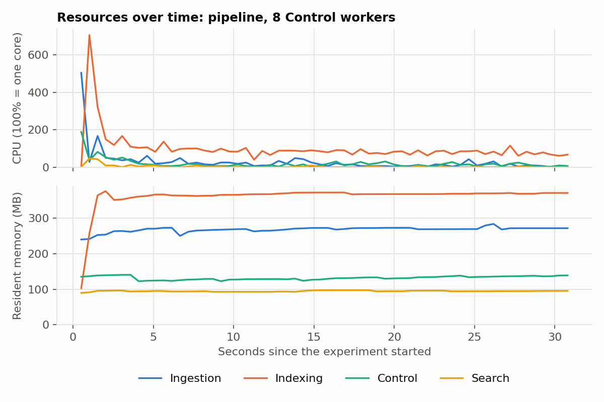

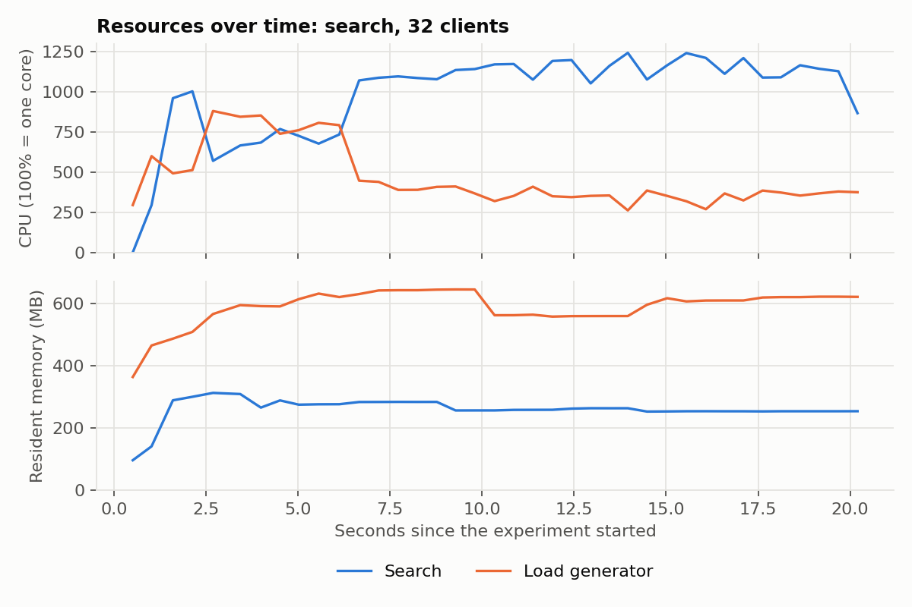

After the first seconds, RSS stays flat for each process, and CPU settles. The host's memory use peaked at 84%, which includes everything else running on the laptop. In the search chart, the load generator uses much more CPU during its first 6 seconds, which overlaps with the warm-up period and may reach slightly into the measurement.

**Tested limits on this machine:** about 6.5 books/s on a small index, falling to about 1.7 at 1000 books; about 7800 requests/s without cache, and 12 500 with an ideal cache, at up to 64 clients.

**Not tested, so nothing is claimed about them:**

- More than 1000 books, or a corpus with real new vocabulary. The replayed corpus understates index growth.
- Combined configurations, such as replicas of Indexing and Search together. Only one factor was changed at a time.
- Long-running stability over hours.
- Open-loop load, where clients do not wait for answers. Closed-loop clients slow down with the server, so they do not show overload.
- Any cross-machine behaviour. **Local speedup, or the lack of it, does not establish how this will scale on a cluster.**

## 7. Conclusions and future improvements

### 7.1 Strengths and weaknesses, as measured

**Strengths.**

- **Correctness held in every test.** 17 failure scenarios pass, and all pipeline and search experiments finished with 0 failed books, 0 search errors, 0 wrong totals, and identical index checksums.
- **The orchestrator is cheap**, at about 3% of a book's time, and a table in one file is easy to inspect and recover.
- **Search is fast and independent of writes**, with p95 under 4 ms up to 16 clients, and it keeps serving during publication.
- **Benchmarks were used to improve the system.** Two defects and one avoidable cost were found and fixed, for +58% in throughput.

**Weaknesses.**

- **Publication is serial, and its cost grows with the index**, about fivefold for a tenfold growth. This is the main limit of the architecture, and on one host nothing in the current design removes it.
- **SQLite ties the datamart to one host.**
- **The Control Module is one process**, and so a single point of failure for new work, although search keeps serving without it.
- **Year filtering covers only books in a curated list.**

### 7.2 Evolution for the Stage 3 cluster

Everything in this section is a **proposal**, informed by the measurements but not tested.

| Single-host assumption | What changes in Stage 3 |
|---|---|
| `localhost` URLs | Real addresses or service discovery. The endpoint lists already accept them |
| Datalake as a local path | A distributed store or object storage. Indexing fetches files from it, or asks Ingestion over HTTP, instead of opening a local path |
| SQLite and its file locks | They cannot span machines. Replaced by the segment design below, or by a database made for it |
| In-process fair lock | Removed along with the single shared write path |
| One Control Module, releasing all claims at startup | Several instances, or one with fast failover. The startup release goes away, and recovery relies on lease expiry, which claims already support |
| Failover among local replicas | The same client logic, with timeouts tuned for real network delays |

**Communication and storage.** HTTP stays between services, since its contracts are already independent of location. Each service already owns its store and reads no other service's database, so these stores can move independently.

**Write path, the main change.** The measurements point to the cause: one big tree, where each book touches thousands of pages. Proposal: index batches of books into **immutable segments**, and publish a segment by atomically updating a manifest, which is a log-structured design like the one Lucene uses. Writing no longer depends on the size of the index, and writers on different machines stop competing for one lock. The cost moves to background merging and to searching several segments, so it must be measured again. It would keep the current rule that publication is one atomic step.

**Distribution of tasks and requests.** Tasks: atomic claims with leases already distribute work, and need a coordination store reachable by all. Requests: a load balancer or gateway in front of Search, since a single front-end URL can no longer be left to clients, and partitioning the index by book or by term when it no longer fits one node, with a fan-out for queries.

**Consistency.** Search currently gets it from a snapshot. Across nodes, each query should use one manifest version, so that it never mixes states, and newly published books may appear on replicas with a short delay. The final check of the workflow then needs a definition: visible on one replica, or on all.

**Network delays and unavailable nodes.** Idempotent steps, retries with backoff and leases were designed for this, and were tested with crashes and outages on one host. New problems include partitions, where a worker believed dead may still be running and two owners may exist. So a late completion must be rejected, for example with a fencing token on the claim. The tests must then inject network faults, not only process crashes.

**What must be measured again.** The results on Search replicas here do not predict a cluster, since on separate machines each replica would bring its own CPU. Whether throughput really grows, and the new costs of the network, must be measured there.

### 7.3 Smaller improvements available now

- A larger SQLite page cache, about 23% per book in section 6.5, if the write path were to stay.
- Batching several books into one transaction, which would touch each leaf page less often. Not tested, and it would delay publication.
- Repeating the benchmarks on an isolated machine, to separate the disk stalls from the system.

## Appendix: requirements and where they are met

| Requirement (section of the assignment) | Where |
|---|---|
| Ingestion, Indexing and Search as services, Java 17 and Javalin (2, 4) | `ingestion-service/`, `indexing-service/`, `search-service/` |
| Explicit coordination mechanism (2.1) | `control-module/`, section 2.2 |
| Book eligible only after ingestion; consistent published state; no duplicates (2.1) | Section 2.2; `failure_check.py` |
| Replicas and threads distinguished, with defaults documented (2.2) | Section 2.3, Figure 1, README |
| Configurable ports, endpoints, paths, replicas and threads (2.3) | README, `scripts/deploy.py` |
| Single-host assumptions identified (2.3) | Sections 2.4 and 7.2 |
| Front-end API: search, filters, pagination, errors (3.1) | `SearchRequest`, `SearchEngine`; section 3.1 |
| Internal APIs, idempotent, with status semantics (3.2) | `api/ENDPOINTS.md`; section 3.2 |
| Versioned specification and separate inventories (3.3) | `api/openapi.yaml`, `api/ENDPOINTS.md` |
| Validation evidence (3.4) | `api_check.py`, `api/requests.http`; section 3.4 |
| Standalone Maven projects with executable jars (4) | One module and jar per service; decision D25 |
| Workflow, and what happens if a process stops (5) | Figure 2, section 4.3 |
| JMH in `src/test/java`, 5 + 10 iterations, fixed heap, CSV (6.3) | `*/src/test/java/**/benchmark`, `scripts/run_jmh.py`, `results/stage2/jmh/` |
| Thread and replica experiments, one factor at a time (6.2) | Sections 6.4 and 6.7 |
| Integration metrics: throughput, latency with p95, CPU and memory, coordination (6.4) | `bench_integration.py`, `results/stage2/integration/`, section 6 |
| Tables, charts, means, deviations, percentiles (6.5) | Section 6, `results/stage2/summary_tables.md`, `results/stage2/charts/` |
| Report sections and cover (7.1) | This document. The cover has the members' names; the student IDs are not in the repository and must be added |
| Repository named `stage_2` (7.2) | https://github.com/Calima-Data/stage_2, with the Stage 1 history and the Stage 2 branch as `main` |
| README instructions (7.2) | `stage2/README.md` |
| History with contributions from all members (7.2) | **Pending**: the Stage 1 history has two authors, and the Stage 2 commits have one |
